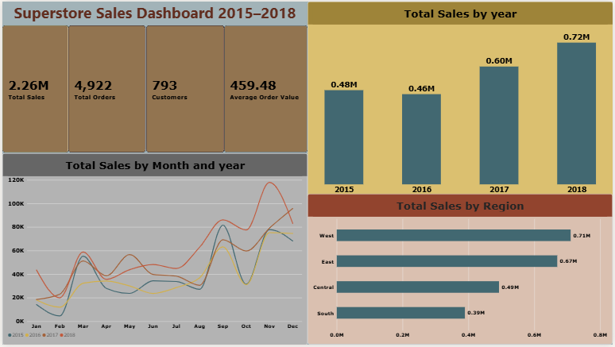

# Superstore Sales Analysis (2015-2018)

End-to-end sales analysis of the Superstore dataset (9,800 rows) using PostgreSQL and Power BI.

## Key numbers
- Total Sales: 2.26M
- Orders: 4,922
- Customers: 793
- Average Order Value: 459.48

## Key insights
- Sales grew from 479,856 (2015) to 722,052 (2018).
- Q4 (Oct-Dec) brings 38.5% of yearly sales.
- West is the top region (31.4%). Technology is the top category (36.6%).
- 98% of customers are repeat customers, but new customers fell to 11 in 2018.

## Tools
PostgreSQL (CTEs, window functions, subqueries), Power BI (Power Query, DAX, charts)

## Files
- `Superstore Project..pbix` - Power BI dashboard
- `superstore_analysis.sql` - 34 SQL queries
- `superstore_analysis_questions.pdf` - the questions answered
- `Superstore_Manager_Summary.txt` - summary for the manager
- `SUPERSTORE_SALES_ANALYSIS_KEY_INSIGHTS.txt` - detailed insights
- `train.csv.zip` - dataset (Kaggle Superstore)

Author: Ayushi Dubey
